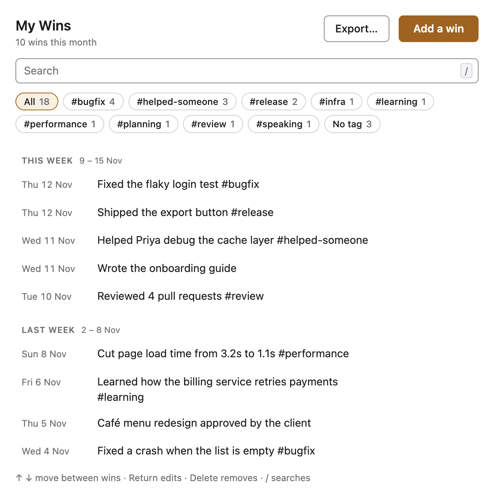
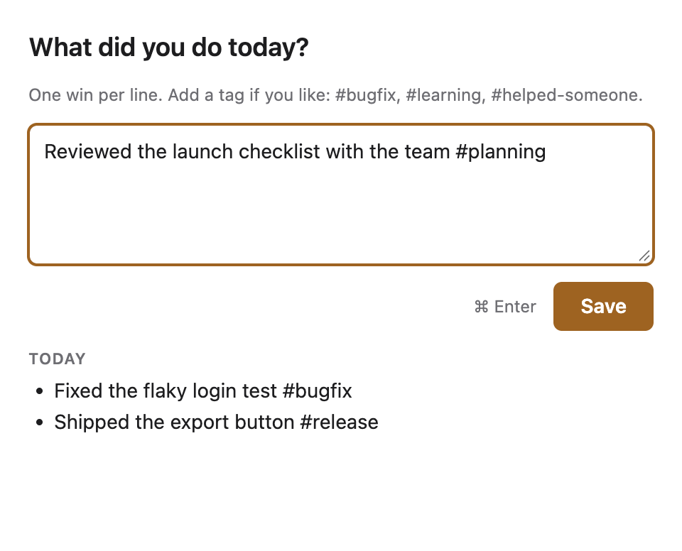
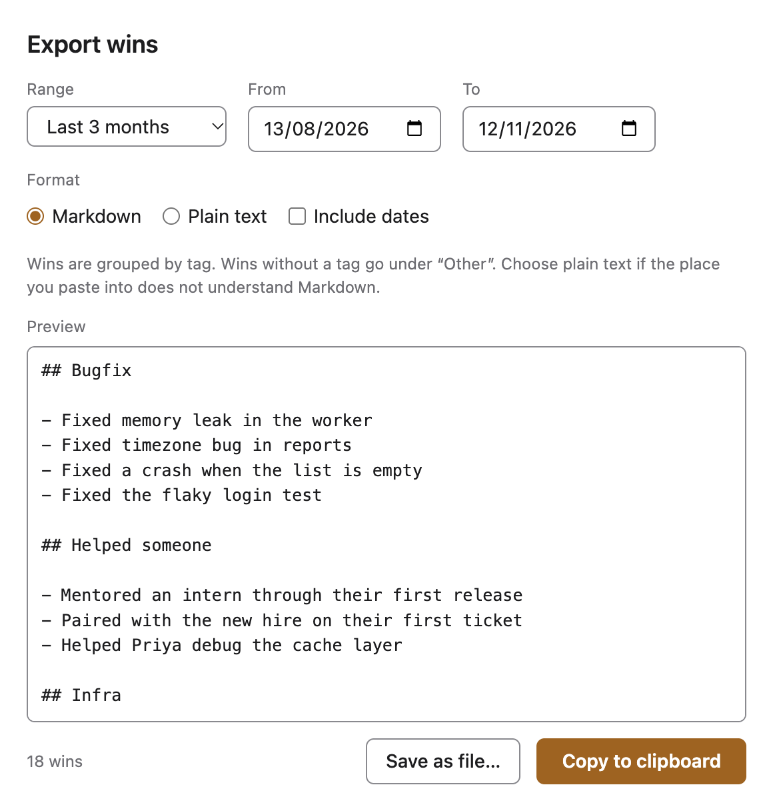

# Win Log

Remember what you did. Have your wins ready at review time.

Win Log is a small app for Mac and Windows that lives in the menu bar or system tray. Once a
day it asks "What did you do today?" and saves your answers (your wins) on your computer. At
review time you export your wins for a date range and paste them where you need them.

- No account, no server, no tracking. Your wins stay on your computer.
- Free and open source, under the [MIT license](LICENSE).

## Screenshots

<!-- These show sample wins, not real ones. Replace the files in docs/screenshots/ to update them. -->







## Download

Download Win Log from the [website][website] or from the [Releases page][releases]. It is free.

| Your computer | File to download |
| --- | --- |
| Mac with macOS 13 Ventura or later (Apple Silicon or Intel) | `Win-Log-<version>-mac.dmg` |
| PC with Windows 10 or 11 | `Win-Log-<version>-windows-setup.exe` |

The Mac `.zip` file has the same app as the `.dmg`, if you prefer a zip. The Windows installer
is for x64 PCs. It also runs on Windows on ARM through emulation.

### Install on Mac

1. Open the `.dmg` file.
2. Drag Win Log to the Applications folder.
3. Open Win Log from Applications. The first time, you will see a warning. See
   [First launch](#first-launch).
4. Look for the star in the menu bar.

### Install on Windows

1. Run the setup `.exe`. The first time, you will see a warning. See [First launch](#first-launch).
2. Win Log installs for your user only, so you do not need admin rights. It adds a Start Menu
   shortcut.
3. Look for the star in the system tray. See [Find the icon](#find-the-icon). If Win Log is not
   running, open it from the Start Menu.

## First launch

### Find the icon

Win Log has no main window. Everything starts from its icon. The first time you open Win Log,
a welcome window shows you where the icon is and lets you choose the reminder time and days.

- **Mac:** a star in the menu bar, at the top right of the screen.
- **Windows:** a star in the system tray, at the bottom right. It may be hidden behind the `^`
  (Show hidden icons) arrow. Drag it onto the taskbar to keep it visible.

The menu has these items: "Today: 2 wins" (how many wins you added today), "Add a win",
"My Wins", "Export…", "Settings…", "About Win Log" and "Quit". Closing a window does not quit
Win Log. Use "Quit".

### Warnings the first time you open it

Win Log is not code-signed yet, because signing costs money. So macOS and Windows warn you the
first time you open it. This is expected. Only follow these steps for a file you downloaded from
the official [Releases page][releases].

#### On a Mac

macOS says Apple could not verify Win Log.

- macOS 13 and 14: in Finder, open Applications, Control-click (or right-click) Win Log, choose
  "Open", then click "Open" again.
- macOS 15 Sequoia and later: try to open Win Log once, then click "Done" in the warning (not
  "Move to Trash"). Then go to System Settings > Privacy & Security, scroll down and click
  "Open Anyway". You may need to confirm with your password.
- If macOS says Win Log "is damaged" and cannot be opened, do not move it to the Trash. Close the
  warning, open Terminal and run this, then open Win Log again:

  ```sh
  xattr -cr "/Applications/Win Log.app"
  ```

#### On Windows

SmartScreen shows "Windows protected your PC". Click "More info", then "Run anyway".
Your browser may also warn that the file is not commonly downloaded. Choose to keep it.

## How to use

### The daily question

By default, Win Log asks "What did you do today?" at 18:00 (6 pm), Monday to Friday.

- The window opens without stealing your typing, so you can finish what you are writing. Click
  it when you are ready.
- It does not ask if you already added a win that day.
- If your computer was asleep or off at that time, Win Log asks when you come back the same day.
  It never asks about a past day.
- To change the time or the days, open "Settings…" > "Daily reminder". To turn the question off,
  untick the main checkbox there, or untick all the days.

### Add a win

You can add a win at any time. Choose "Add a win" in the menu, or press the keyboard shortcut:

| System | Default shortcut |
| --- | --- |
| Mac | ⌃⌥W (Control+Option+W) |
| Windows | Ctrl+Alt+Shift+W |

To change it, open "Settings…" > "Add-a-win shortcut". If the shortcut does nothing, another app
may be using the same keys. Pick a different one.

Type one win per line. Each line becomes one win.

### Tags

Add a tag with `#` and a word, for example `#bugfix`.

```text
Fixed the login timeout bug #bugfix
Helped a new teammate set up the test server #mentoring
Wrote the planning doc for next quarter
```

- The first `#tag` in a line is the one Win Log uses.
- A tag starts with a letter, so `#123` is not a tag.
- Tags are optional. In an export, wins without a tag go under "Other".

### My Wins

"My Wins" shows all your wins, grouped by week (weeks start on Monday), newest first.

- Type in the search box to find a win. Click a tag chip to show only that tag.
- You can edit a win, or delete it. Win Log asks before it deletes anything.
- Keyboard: `/` jumps to search. The Up and Down arrows move between wins. Enter edits the
  selected win. Delete (Backspace on Mac) deletes it, after asking.

### Export

"Export…" turns your wins into text you can paste into a review.

1. Pick a range: "This month", "Last month", "Last 3 months", "Last 6 months", "This year" or
   "Custom".
2. Pick a format:
   - "Markdown": bullets grouped by tag. Wins with no tag go under "Other".
   - "Plain text": for HR tools that do not accept Markdown.
3. Tick "Include dates" if you want the date of each win. It is off by default.
4. Check the live preview, then click "Copy to clipboard" or "Save as file…".

### Your data and backups

Win Log saves your wins in plain JSON files in its data folder:

- Mac: `~/Library/Application Support/Win Log/`
- Windows: `%APPDATA%\Win Log\`

`wins.json` holds your wins and `settings.json` your settings. Before the first change of each
day, Win Log copies `wins.json` into the `backups` folder. It keeps the newest 14 copies.

In "Settings…" > "Your data":

- "Open data folder" shows the folder.
- "Export backup…" saves a backup of your wins as a `.json` file.
- "Import backup…" adds wins from a backup file that are not already in Win Log. It shows a
  summary first. It never overwrites a win you already have.
- "Also save daily backups to a folder I choose": tick it and pick a folder. Pick one inside your
  own iCloud Drive, Google Drive or OneDrive to get a synced copy of your backups for free. On
  each day that your wins change, Win Log saves a copy there. The file name includes your
  computer's name, for example `win-log-backup-My-Laptop-2026-11-12.json`. Win Log keeps the
  newest 14 copies from this computer and never touches any other file in that folder. Your live
  data always stays in the normal data folder.

You can also back up by copying `wins.json` yourself.

**Move to a new computer:** on the old computer, use "Export backup…". Install Win Log on the new
computer, then use "Import backup…". Or quit Win Log on both computers and copy `wins.json` into
the new data folder.

### Start at login

"Start Win Log at login" is on by default. You can turn it off in "Settings…". Win Log respects
changes you make in macOS System Settings > General > Login Items, or in Windows Task Manager >
Startup apps.

### About and updates

"About Win Log" shows the version and the license. "Check for updates" opens the
[Releases page][releases] in your browser. "Report a problem" opens [GitHub Issues][issues] in
your browser. Win Log does not update itself. To update, choose "Quit" in the Win Log menu, then
download and install the new version the same way as the first time. Your wins stay in the data
folder. Because Win Log is not code-signed yet, you may see the first-launch warning again.

### Uninstall

- **Mac:** choose "Quit" in the Win Log menu, then drag Win Log from Applications to the Trash.
- **Windows:** open Settings > Apps > Installed apps (Apps & features on Windows 10), find
  Win Log and choose "Uninstall".

Your wins stay in the data folder until you delete that folder.

## Privacy

Win Log has no account, no server, no analytics and no tracking. The app makes no network
connections at all. Links in the app open in your browser only when you click them. Read the
full [privacy policy](PRIVACY.md).

## Build from source

You need [Node.js](https://nodejs.org/) 22.12 or later and git.

```sh
git clone https://github.com/ayushCodes/win-log.git
cd win-log
npm ci       # install the exact dev dependencies from package-lock.json
npm start    # run the app in development
npm test     # run the unit tests (node --test)
```

To build the installers:

```sh
npm run dist:mac    # on a Mac: the .dmg and .zip
npm run dist:win    # on Windows: the setup .exe
```

The files go to `dist/`. The settings are in `electron-builder.js`. Builds are unsigned unless
a signing certificate is set in the environment. See [RELEASE.md](RELEASE.md).

"Start Win Log at login" and the hidden Dock icon on Mac can only be checked in a packaged build,
not with `npm start`.

## Project layout

```text
src/main/       main process: start-up, tray, windows, reminder, shortcut, IPC, data store
src/lib/        pure logic with no Electron imports (dates, schedule, tags, search, export, backup)
src/preload/    preload.js: the small window.winlog API the windows use
src/renderer/   one folder per window (HTML + JS) and a shared common.css
assets/         tray and app icons
build/          app icons used to package the installers
scripts/        helper scripts, such as the one that makes the icons
test/           unit tests (node:test)
docs/           the website (GitHub Pages) and screenshots
```

The full project rules are in [CLAUDE.md](CLAUDE.md).

## Contributing

Bug reports and small, focused pull requests are welcome. Please read
[CONTRIBUTING.md](CONTRIBUTING.md) first.

## License

[MIT](LICENSE). Copyright (c) 2026 Ayush Bundela.

[website]: https://ayushcodes.github.io/win-log/
[releases]: https://github.com/ayushCodes/win-log/releases/latest
[issues]: https://github.com/ayushCodes/win-log/issues
